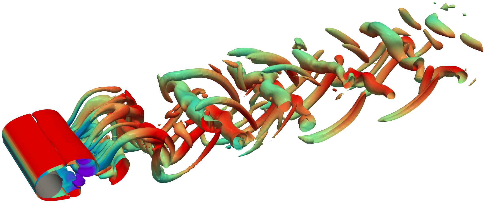
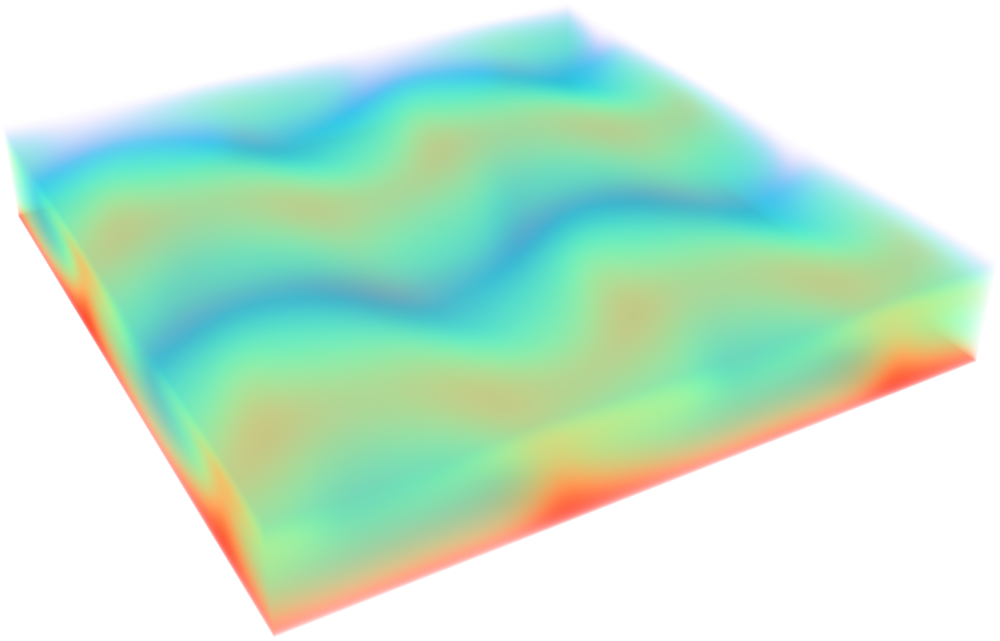
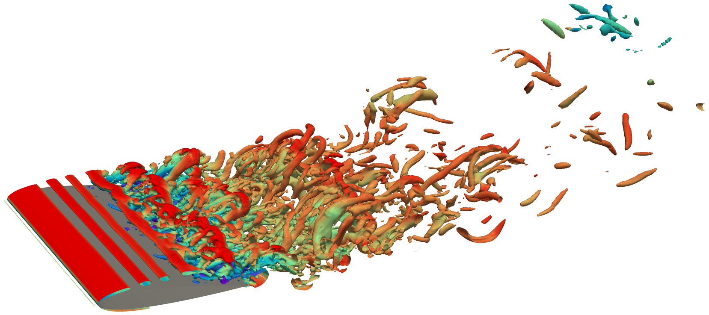
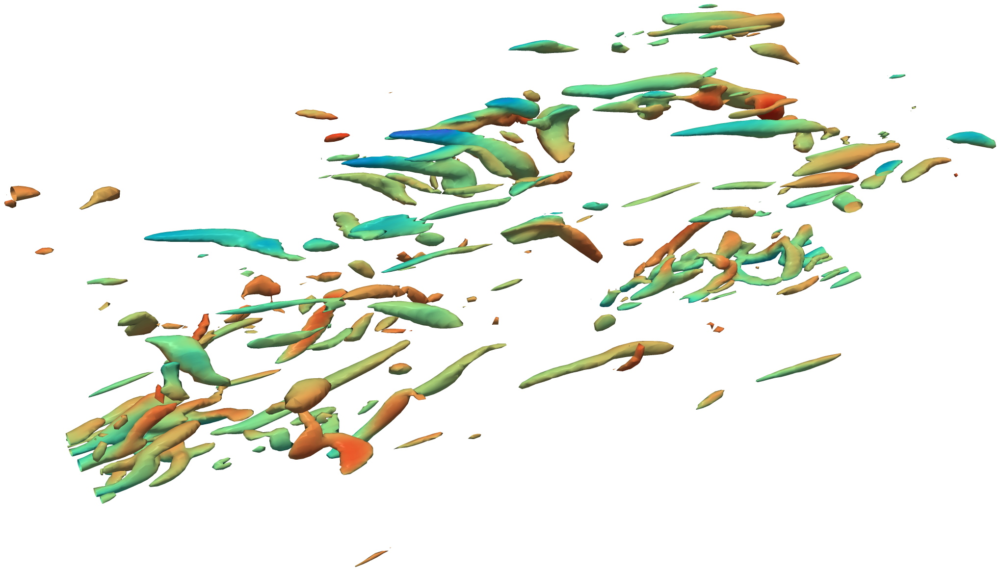
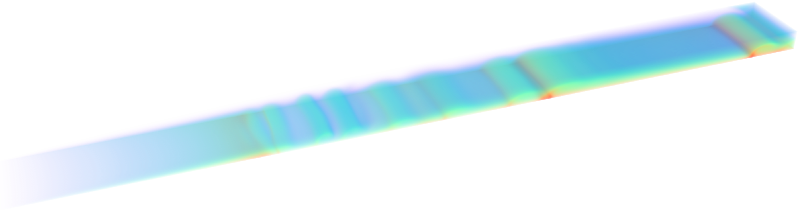
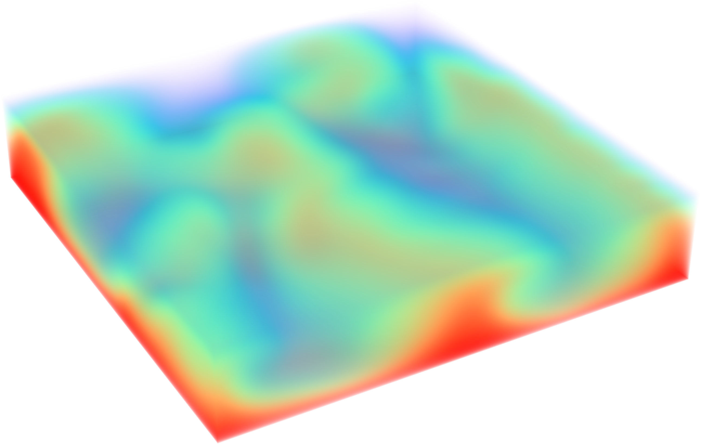

<p align="center">
    <a href="./docs/source/_static/img/logo_lm.png#gh-light-mode-only">
        
    </a>
    <a href="./docs/source/_static/img/logo_dm.png#gh-dark-mode-only">
        
    </a>
</p>

<div align="center">


[](https://github.com/upb-sciml/phiPICT/actions/workflows/release.yml)
[](https://github.com/upb-sciml/phiPICT/actions/workflows/docs.yml)

</div>

<h1 align="center">φ-PICT: Differentiable GPU-Accelerated Solver for Hydrodynamic &amp; Magnetohydrodynamic Flows</h1>

---

<div align="center">
    <h3>
      <a href="#installation">Installation</a> |
      <a href="#getting-started">Getting Started</a> |
      <a href="https://upb-sciml.github.io/phiPICT/docs/">Documentation</a> |
      <a href="#license">License</a>
    </h3>
</div>

---

<table align="center">
  <tr>
    <th width="30%">Flow Past a Cylinder</th>
    <th width="20%">Rayleigh-Bénard Convection</th>
    <th width="28%">Airfoil</th>
    <th width="22%">Turbulent Channel Flow</th>
  </tr>
  <tr>
    <td align="center"></td>
    <td align="center"></td>
    <td align="center"></td>
    <td align="center"></td>
  </tr>
  <tr>
    <th colspan="3">Fusion Reactor Blanket Cooling (MHD)</th>
    <th>MHD Rayleigh-Bénard Convection</th>
  </tr>
  <tr>
    <td align="center" colspan="3"></td>
    <td align="center"></td>
  </tr>
</table>

---

## Key Features

- **Differentiable Physics:** Fully end-to-end differentiable solver supporting Backpropagation Through Time (BPTT/APG), Short-Horizon Actor-Critic (SHAC) and more.
- **Massively Batched Execution:** Efficiently parallelize over 100 of independent fluid environments on a single GPU.
- **MHD & Standard Hydrodynamics:** Simulates both magnetohydrodynamic (MHD) flows and standard hydrodynamic fluid mechanics.
- **RL Framework Integration:** Seamlessly integrated into [FluidGym](https://github.com/upb-sciml/fluidgym) for plug-and-play benchmarking of control algorithms.

## Installation

phiPICT needs Linux, an NVIDIA GPU with a driver for CUDA 12.8 (≥ 570) and
Python 3.11–3.13.

### 📦 Installation from PyPI

```bash
pip install phipict
```

This also installs the matching PyTorch (2.10, built with CUDA 12.8), pyamg, and
the remaining runtime dependencies (NumPy, SciPy, matplotlib, imageio, psutil).
There is no need to install PyTorch first: the compiled extension only works with
the PyTorch version it was built against, so pip replaces any other version.
For other PyTorch or CUDA versions, use a prebuilt wheel from our wheel index or
build from source (see below).

Optional extras:

```bash
pip install "phipict[dev]"   # linters, type checking, and tests
pip install "phipict[docs]"  # Sphinx, to build the documentation
```

Reading VTK formats other than `.vts`/`.vtm` needs `pip install pyvista`.

### 🎡 Other PyTorch Versions

Prebuilt wheels for other PyTorch/CUDA combinations are available from our
[wheel index](https://upb-sciml.github.io/phiPICT/whl/):

| PyTorch | CUDA 12 (driver ≥ 570) | CUDA 13 (driver ≥ 580) |
|---|---|---|
| 2.10 | PyPI default (`pip install phipict`) | – |
| 2.13 | – | ✓ |
| 2.14 | ✓ | ✓ |
| 2.15 | – | ✓ |

Install PyTorch first, then the phiPICT wheel matching its version, e.g. for
PyTorch 2.14 with CUDA 12.6:
```bash
pip install "torch==2.14.*" --index-url https://download.pytorch.org/whl/cu126
pip install phipict -f https://upb-sciml.github.io/phiPICT/whl/torch-2.14+cu12.html
```
The page name is `torch-<PyTorch minor>+cu<CUDA major>.html`. For the PyTorch
already installed in your environment:
```bash
pip install phipict -f "https://upb-sciml.github.io/phiPICT/whl/torch-$(python -c 'import torch; v = torch.__version__.split("."); print(f"{v[0]}.{v[1]}+cu{torch.version.cuda.split(".")[0]}")').html"
```

### 🧱 Build from Source

Building from source compiles the CUDA kernels against the PyTorch installed in
your environment. Here is an example for Python 3.12 and CUDA 12.8.

1. Create a new conda environment and activate it:
```bash
conda create -n phipict python=3.12
conda activate phipict
```

2. Install the CUDA toolkit from conda-forge. This also installs a gcc/g++ that
   the chosen nvcc supports, so no separate compiler install is needed. The CUDA
   major version must match the one your PyTorch build uses (12 here):
```bash
conda install -c conda-forge pip cuda-toolkit cuda-version=12.8
conda env config vars set CUDA_HOME="$CONDA_PREFIX"
conda activate phipict  # re-activate so CUDA_HOME takes effect
```

3. Install PyTorch for the same CUDA version via pip. Any version ≥ 2.9 works;
   the extension is then bound to this version:
```bash
pip install "torch==2.10.*" --index-url https://download.pytorch.org/whl/cu128
pip install "setuptools>=77"  # the build uses the environment's setuptools
```

4. Clone the repository and enter the directory, then compile the custom CUDA
   kernels and install the package (this might take several minutes):
```bash
make install
```

For development, use `make install-dev` instead, which installs the package in
editable mode together with the development dependencies.

The documentation dependencies are installed via `pip install ".[docs]"`.

## Getting Started

See the [`examples`](examples) directory for example simulations.

## License

This repository is published under the Apache-2.0 license.
