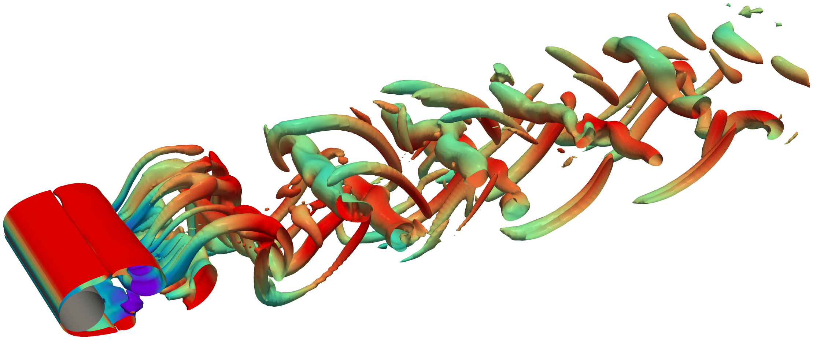
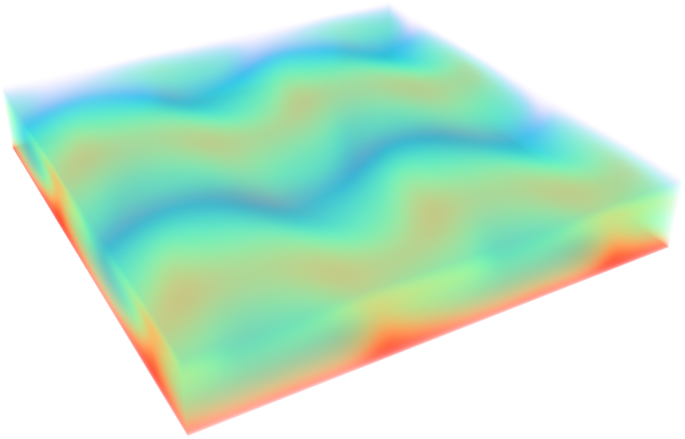
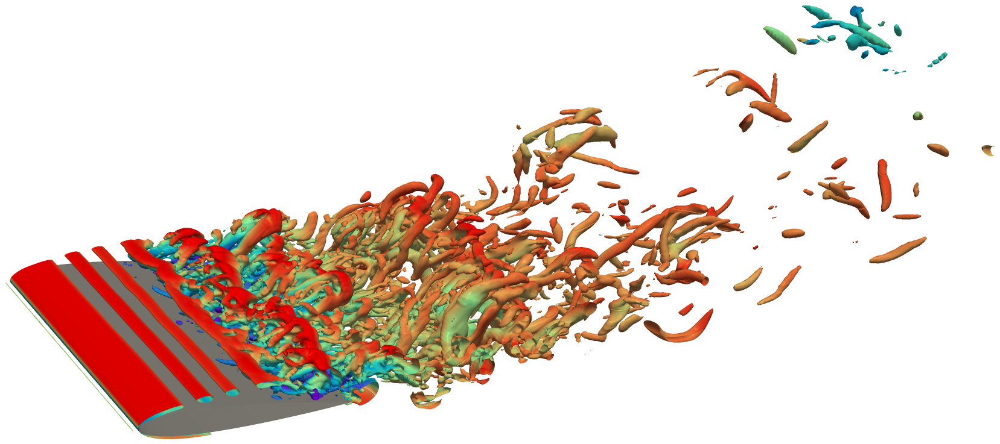
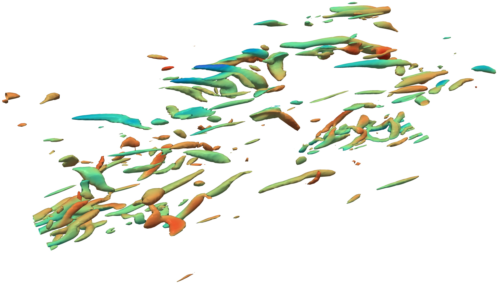
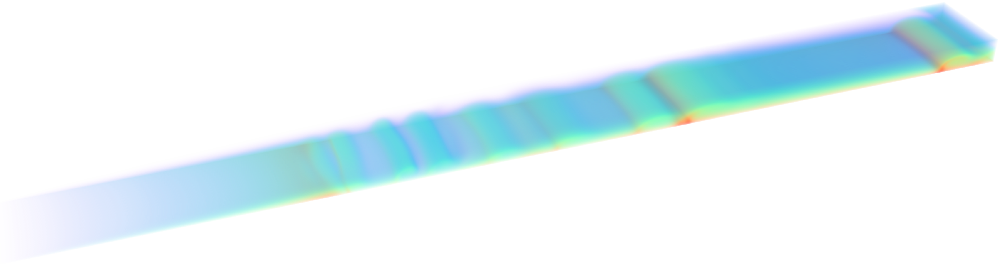
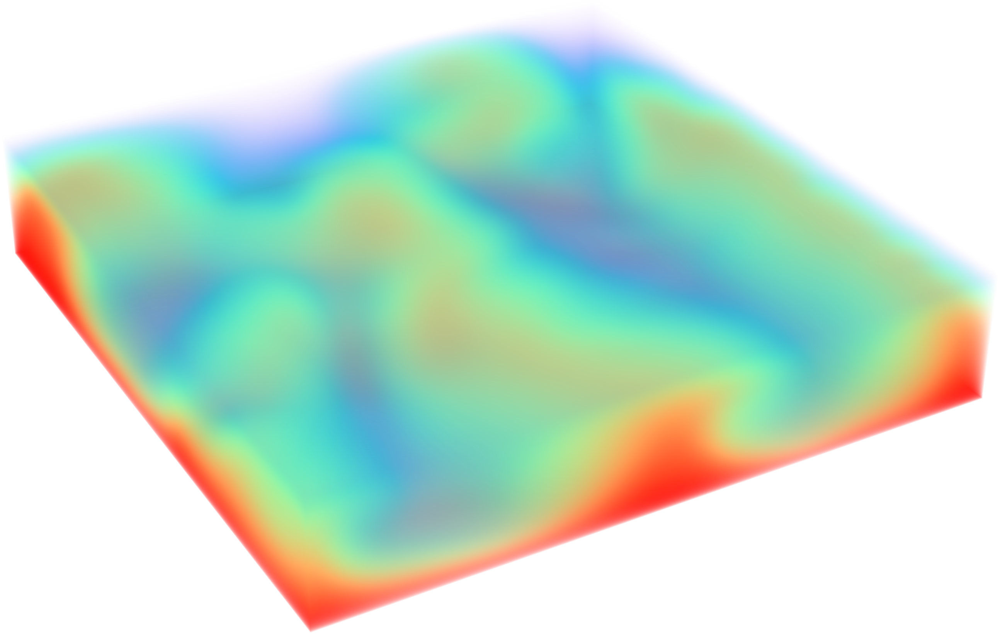

Examples
========

The scripts in ``examples/`` are self-contained: each builds its mesh with
:mod:`phipict.meshing`, sets the boundary conditions and runs the simulation.
All of them need a CUDA GPU. Most take ``--out`` to write the solution as a VTK
time series for ParaView.

Validation cases
----------------

These scripts run small versions of the validation cases in
``runscripts/validation`` (same grids as the coarsest validation runs) and
compare the result with the analytical solution.

Hartmann flow (2D)
~~~~~~~~~~~~~~~~~~

A channel flow with insulating walls at :math:`y = \pm 1` and a transverse field
along :math:`y`. A constant pressure gradient :math:`G` drives the flow, and the
steady profile is

.. math::

    u(y) = \frac{G}{N} \left(1 - \frac{\cosh(Ha\, y)}{\cosh Ha}\right).

.. code-block:: bash

    python examples/hartmann.py --ha 10

Shercliff and Hunt flow (3D)
~~~~~~~~~~~~~~~~~~~~~~~~~~~~

A square duct with walls at :math:`y = \pm 1` (Hartmann walls) and
:math:`z = \pm 1` (side walls), field along :math:`y`. With ``--cw 0`` all walls
are insulating (Shercliff flow). With ``--cw 0.1`` the Hartmann walls are thin
conducting walls (Hunt flow). The analytical reference is Hunt (1965).

.. code-block:: bash

    python examples/duct.py --cw 0      # Shercliff
    python examples/duct.py --cw 0.1    # Hunt

Meshing
-------

Flow past a cylinder
~~~~~~~~~~~~~~~~~~~~

A cylinder in a channel, meshed with :class:`~phipict.meshing.BlockMesh`: an
O-grid of four blocks around the cylinder inside a 3 x 3 arrangement of channel
blocks. Only some cell counts are given, the others are inferred from shared
edges, and the twelve block connections are found automatically. The inflow is a
parabolic profile, and the solution is written as a VTK time series. ``--three-d``
extrudes the mesh, periodic in z. See :doc:`meshing/index`.

.. code-block:: bash

    python examples/cylinder.py --steps 200 --out out/cylinder

OpenFOAM blockMeshDict
~~~~~~~~~~~~~~~~~~~~~~

Runs the channel of ``examples/meshes/flow_past_cylinder/blockMeshDict`` (3 x 3
blocks, read as 2D from its ``empty`` patches) after giving its patches flow
conditions.

.. code-block:: bash

    python examples/blockmesh_import.py --steps 100

Hydrodynamic flows
------------------

Four standard flows in ``examples/hydro``, each in a single file with its
default geometry, boundary conditions and physical parameters. ``--three-d``
switches the cylinder, airfoil and Rayleigh-Bénard cases to 3D; the channel flow
is always 3D.

Flow past a cylinder (vortex street)
~~~~~~~~~~~~~~~~~~~~~~~~~~~~~~~~~~~~

The benchmark of Schäfer & Turek (1996) at Re = 100: a cylinder of diameter 1,
slightly off-centre in a 22 x 4.1 channel, with a parabolic inflow and an
advective outflow. An O-grid of four blocks (quarter rings joined with quads,
:meth:`~phipict.meshing.MeshBlock.concat`) surrounds the cylinder, and a fifth
block holds the wake.

.. code-block:: bash

    python examples/hydro/cylinder.py
    python examples/hydro/cylinder.py --three-d

Rayleigh-Bénard convection
~~~~~~~~~~~~~~~~~~~~~~~~~~

A fluid layer of height 1 between a hot bottom plate (T = 1) and a cold top
plate (T = 0), periodic in x (and z), in the free-fall scaling. Buoyancy is
added as a velocity source before every step. Defaults: Ra = 8e4 in 2D and
Ra = 2e3 in 3D, Pr = 0.7.

.. code-block:: bash

    python examples/hydro/rbc.py
    python examples/hydro/rbc.py --three-d

Airfoil
~~~~~~~

A NACA 0012 airfoil at 10 degrees angle of attack in a channel at Re = 3000. A
C-type grid of six blocks follows the airfoil surface (:class:`~phipict.meshing.Points`
edges) and continues into the wake, where the cells grow by 1% per cell towards
the outlet.

.. code-block:: bash

    python examples/hydro/airfoil.py
    python examples/hydro/airfoil.py --three-d

Turbulent channel flow
~~~~~~~~~~~~~~~~~~~~~~

A direct numerical simulation of the flow between two plates at
:math:`Re_\tau = 180`, periodic in x and z. A uniform force balances the wall
shear stress, and the flow starts from Reichardt's mean profile plus
divergence-free noise. ``--large`` doubles the channel in x and z.

.. code-block:: bash

    python examples/hydro/tcf.py
    python examples/hydro/tcf.py --large

Magnetohydrodynamic flows
-------------------------

Two liquid-metal flows in ``examples/mhd`` with heat transfer and a strong
magnetic field, see :doc:`mhd`.

Fusion reactor blanket cooling
~~~~~~~~~~~~~~~~~~~~~~~~~~~~~~

A duct of length L = 75 (``--length``) and cross-section 7 x 2 carries a liquid
metal (Pr = 0.025) through a transverse magnetic field (Ha = 200, Re = 5000). One
side wall is heated, and buoyancy acts along the flow (Gr = 1.25e6). The inlet
has a parabolic profile, the outlet is an advective outflow, and the field ramps
up over the first unit of the duct (a spatially varying ``e_b``).

.. code-block:: bash

    python examples/mhd/blanket_cooling.py
    python examples/mhd/blanket_cooling.py --length 18.75

Magnetoconvection
~~~~~~~~~~~~~~~~~

Rayleigh-Bénard convection in a closed 5 x 1 x 5 box with a horizontal magnetic
field along x (Ra = 5e4, Q = Ha² = 1e3, Pr = 0.025). The field aligns the
convection rolls with it. The walls normal to the field carry thin Hartmann
layers, and the mesh is refined until each of them holds three cells.

.. code-block:: bash

    python examples/mhd/rbc_mhd.py
